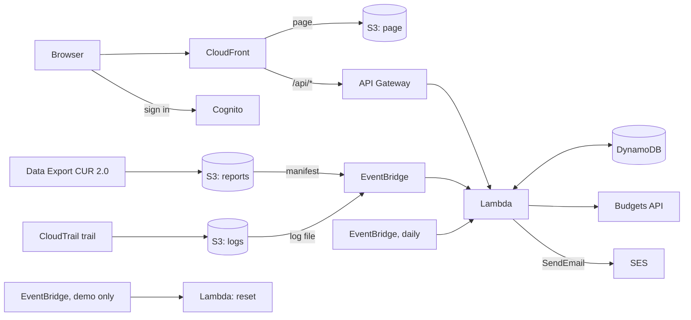

# AWS account

An overview of an AWS account, running serverless on AWS: what it costs by day, service, project and region, its budgets, the CloudTrail of every day with the events behind it, and findings — suspicious calls and jumps of the costs — on the page and by mail.

Everything is Terraform and AWS managed services: no servers, nothing running between the reports and the page views, so an installation costs cents a month (see [Cost](#cost)). It reads the Cost and Usage Report and the CloudTrail logs the account already writes to S3; Cost Explorer (a cent a request) and CloudTrail Lake are not used.

## Why

**What happened, without the console.** CloudTrail and the cost report are in S3, but reading them means Athena, the Cost Explorer or the console of each service. Here a day of CloudTrail is a page: how many calls, changes, errors and sign-ins, by whom, to what and from where, and every change and error with its request. A click on a principal, a service or an error narrows it all down, and the values add up: a principal and a service are the calls of that principal to that service.

**Being told, not looking.** The rules look at every log file as it arrives — the root user, a sign-in without MFA, CloudTrail stopped, an access key or a user made, administrator rights, a bucket opened to everyone, a port open to the internet, a change in a region nobody uses, a principal or a sign-in address never seen before — and at the costs every day: a budget over its limit, a day that cost twice the usual, a service new this month. Critical findings are mailed at once, the rest come with a daily digest.

**For a small account.** The whole stack fits in the free allowances of a personal or a small team account; no WAF, no Security Hub, no paid query engine.

## Demo

The address is the output `site_url` of the deployment of this repository.

Sign in with `demo@example.com` / `Demo-Password-1` (the fields are filled in for you).

The demo shows a **made-up account**, `123456789012`, and reads nothing of the AWS account it runs in: three months of costs of a small web shop (a website, an orders API, a build server, a little AI assistant new this month) with a spike two days ago and two budgets, and thirty days of CloudTrail — Terraform from GitHub Actions, two people signing in through IAM Identity Center, a CI user, a Lambda function and AWS services — with the incidents of [`seed/seed.json`](seed/seed.json): the root user signing in, CloudTrail stopped for a few minutes, a contractor's user made, a security group opened on port 22, failed sign-ins and a sign-in without MFA from a new address, an instance in an unexpected region, a bucket made public, a burst of denied calls. The costs, the counters, the events and the findings are made by the same code that reads a real account: the reset writes lines of a cost report and CloudTrail records and hands them to it.

Everything a visitor may do works: the filters, the charts, the events and their requests, the findings, acknowledging them, the rules in the settings, the language and the mails a user wants. The demo user is an administrator, so the users are there to look at; changing them is not, and "Refresh" and "Load from S3" are off, as there is no account to read. The account is made again at the first reset of every day (UTC), dated back from that day; every hour the reset adds the CloudTrail records of the hour, so the day goes on, puts back the rules, the mails and the acknowledged findings, and deletes any other user. Changing the password and two-factor authentication are hidden in the demo, so no visitor can lock the others out.

## Features

- **Costs** from the Cost and Usage Report 2.0 (a Data Export to S3), read when its manifest arrives, a few times a day: the month by day with a chart split by service, by service, project (the value of a cost allocation tag), region, line type (usage, tax, credits) and usage type, the forecast of the month, the months before.
- **Budgets** from the Budgets API, once a day: actual, forecast and limit.
- **CloudTrail**: every log file read when it arrives — counters of each day (calls, changes, errors, sign-ins; the busiest principals, services, regions, error codes and changes), the events worth showing (changes, errors, sign-ins, the root user, whatever a rule found) with their request for `event_days` (90), and the calls by combination of principal, service, event, region, error and address, which the filters count on.
- **Filters** of a day: a text, only changes, only errors, and values clicked in the lists of the day or in the table of events, all at once; the tiles, lists and the chart of the days show what the filter keeps, reads included.
- **Findings** of 20 rules, critical or warning; administrators turn rules off, set the regions where changes are expected and the principals no rule looks at (patterns such as `role/Terraform/*`), and acknowledge findings.
- **Mails** through SES: critical findings at once (the same rule and principal at most once an hour), a daily digest of the costs, budgets, the day of CloudTrail and the findings; each user picks theirs, in the language of their page.
- **Load from S3**: an administrator reads any days of the CloudTrail logs and the cost reports of their months again — what arrived before the stack, or after the events expired — and keeps them for as long as they say. A day read again replaces what was there, so nothing counts twice; it makes no findings and no mails.
- **Sign-in through AWS SSO**, optional: IAM Identity Center as a SAML identity provider of the user pool, a button on the sign-in page and a tile in the AWS access portal; administrators by their groups in Identity Center, looked up at every token.
- **Charts** in SVG: a click on the legend hides or shows a series, a double click shows it alone.
- **Version**: Settings → Version shows the version of the site and the releases of this repository that came after it.
- **Account**: two-factor authentication with an authenticator app (TOTP), password change; the page and the mails in English, Russian, French and Italian.

## How it works



| Part | Service |
| --- | --- |
| Page | S3 + CloudFront, on its own domain or on the `*.cloudfront.net` address |
| Sign-in | Cognito user pool, no self sign-up, optional TOTP; group `admins`; optional SAML provider IAM Identity Center |
| API | API Gateway HTTP API with a Cognito JWT authorizer, Lambda `lambda/app.py` (Python, arm64) |
| Costs | the Cost and Usage Report 2.0 of the account in S3 (`reports_bucket`), CSV gzipped |
| Budgets | Budgets API (`DescribeBudgets`, free), once a day |
| CloudTrail | the trail's bucket of the account (`trail_bucket`) |
| Data of the page | DynamoDB on demand, one table |
| Mails | SES from `sender_address` (production) |
| Demo | Lambda `lambda/reset.py`, EventBridge `rate(1 hour)` |

The page reads the table only, never S3 or the AWS APIs: everything it shows is what the reports, the logs and the daily job left there. That is what lets the demo fill the table with a made-up account.

### Costs

The Data Export writes the report of a month under `<prefix>/data/BILLING_PERIOD=<YYYY-MM>/` and ends every refresh with a manifest under `<prefix>/metadata/`. The manifest wakes the function, which reads every file of the month again and writes its sums (`pk = COST`, `sk = <YYYY-MM>`): in total, by line type, by day, service, region, project, day and service, and the costliest usage types. "Usage" leaves out tax, credits and refunds, and the spikes are looked for in it: a day that cost at least `spike_min_usd` (0.5) and more than `spike_factor` (2) times the median of the 14 days before it. The day looked at is the one before yesterday: yesterday is still filling in.

### CloudTrail

Every new log file (`*/CloudTrail/*.json.gz`; the digests do not match) goes to the function. Files of one day arrive side by side, so the counters of a day are written on condition that nobody wrote them in between, and read again if somebody did. The events of a day keep what is worth showing; a read that worked is only counted. A principal that changed something, or a sign-in address of a principal, seen for the first time is a finding — after a week of learning, so that the first days do not flood the digest.

Each log file also writes a small item of the combinations of its calls (`pk = COMBOS#<day>`), which the daily job folds into one item a day; the filters count on them, so a filter of 14 days reads 14 items. A read has no event name in its combination: there are too many of them.

### Load from S3

The function reads only what arrives after it is deployed. Settings → Load from S3 (administrators) asks for days up to yesterday, how many days to keep them, and the CloudTrail logs, the cost reports of their months or both. The job runs in invocations of the function of its own, a day of the logs or a month of the report at a time, hands the rest on to the next while it runs out of time, and shows how far it got; one runs at a time, and it can be stopped. A day is read whole — the files of every region of the day and of the first hour of the next — and replaces the counters, combinations and events of that day; no rule runs on it. The events expire after the days asked, but not before `event_days` after their time, and what the table keeps for good stays so.

## Test environment and production

The defaults deploy the **test environment**, the public demo above:

- no domain: the page answers at its `*.cloudfront.net` address with CloudFront's certificate, and no DNS is touched;
- nothing of the account is read: no report, no log, no budget, and no permission for them;
- no SES identity and no mails;
- the sign-in is published and filled in (`demo = true`), password change and two-factor authentication are hidden, and the administration of the users is read-only;
- the reset (`reset_schedule`) makes the account of `seed/seed.json`;
- point-in-time recovery is off, and the page bucket is deleted with its content on `terraform destroy`.

**Production** reads your account. Start from [`examples/production.tfvars`](examples/production.tfvars):

| Variable | Test environment (default) | Production |
| --- | --- | --- |
| `name` | `account-serverless` | `account` — the prefix of every resource |
| `demo` | `true` | `false` |
| `domain_name`, `route53_zone_name` | `""` — the CloudFront address | `aws.example.com`, `example.com` |
| `reports_bucket`, `cur_prefix` | `""` — no costs | the bucket and `<S3 prefix>/<export name>` of the Data Export |
| `trail_bucket` | `""` — no CloudTrail | the bucket of the trail |
| `sender_address` | `""` — no SES, no mails | `alert@aws.example.com` |
| `admin_email` | `demo@example.com` | your address |
| `admin_password` | `Demo-Password-1` | `""` — Cognito mails a temporary password |
| `reset_schedule` | `rate(1 hour)` | `""` — no reset, no examples |

What the account needs, made outside this stack (they belong to the account, not to the page):

1. **A Data Export** of the type "Standard data export", table `COST_AND_USAGE_REPORT` (CUR 2.0), daily, CSV gzipped, overwriting, to an S3 bucket in the region of the stack; `cur_prefix` is its S3 prefix and its name. The bucket policy has to let `bcm-data-exports.amazonaws.com` and `billingreports.amazonaws.com` write. A cost allocation tag (`cost_tag`, `Project`) splits the costs by project once it is activated in Billing.
2. **A trail** of the management events of all regions to an S3 bucket in the region of the stack, without a key prefix (the load reads `AWSLogs/<account>/CloudTrail/…`); `trail_kms_key_arn` if it is encrypted with KMS.
3. **EventBridge notifications** on both buckets (`aws_s3_bucket_notification` with `eventbridge = true`, or Properties → Amazon EventBridge in the console): the new manifests and log files reach the function through them.

Steps to production:

1. Pick a fresh `name` (and state key): production is a separate deployment, not a change of the demo.
2. The domain needs a public Route 53 zone in the same account (`route53_zone_name`): the stack validates the certificate there and writes the alias records.
3. With `sender_address` the stack makes `domain_name` an SES identity (`ses.tf`): Easy DKIM, a MAIL FROM domain `mail.<domain_name>` and DMARC, in the same zone. While the SES account of the region is in the sandbox, mails reach only verified addresses.
4. Sign in with the temporary password Cognito mails to `admin_email`. Invite the others in Settings → Users.
5. To fill in what came before, use Settings → Load from S3.

### Sign-in through AWS SSO

Optional, with a domain. IAM Identity Center makes SAML applications in the console only:

1. IAM Identity Center → Applications → Add application → I have an application I want to set up → SAML 2.0.
2. Application start URL `https://<domain_name>/?login=sso`; Application ACS URL — the output `sso_acs_url` (`https://<sso_domain_name>/saml2/idpresponse`), Application SAML audience — the output `sso_audience`.
3. Attribute mappings: `Subject` → `${user:email}` (format `emailAddress`), and `email` → `${user:email}` (format `unspecified`).
4. The URL of "IAM Identity Center SAML metadata file" goes into `sso_metadata_url`, the sign-in domain (such as `auth.aws.example.com`, in the same zone) into `sso_domain_name`, the groups whose members are administrators into `sso_admin_groups`. Assign the application to the groups who may sign in, and apply.

## Deploy

### What you need

1. An S3 bucket for Terraform state (the S3 backend with the native lockfile, Terraform 1.10+).
2. The GitHub OIDC provider in the AWS account and a role for this repository that trusts only jobs of the GitHub environment `demo`. Its permissions: everything named with the `name` prefix (`s3:*` on `arn:aws:s3:::account-serverless-*`, the table, functions, roles with `iam:PassRole`, log groups, SSM parameters, EventBridge rules), API Gateway, Cognito and CloudFront (their ids are generated), log delivery for API access logs, and the state objects under the state key prefix. The demo needs no SES, ACM, Route 53, Budgets or access to the buckets of the account; production adds them.
3. In the GitHub repository: the environment `demo`, and the variables `AWS_ROLE_ARN` (the role) and `TF_STATE_BUCKET` (the state bucket). There are no secrets.

### GitHub Actions

[`.github/workflows/terraform.yml`](.github/workflows/terraform.yml) only calls the shared workflow of [Tozapid/demo-ci-cd-skeleton](https://github.com/Tozapid/demo-ci-cd-skeleton):

- every push and pull request: `terraform fmt` and `terraform validate`; the Lambda tests; the page's syntax check;
- pull requests from this repository: `terraform plan` in the environment `demo`;
- a push to `main` or a manual run: plan and apply in the environment `demo`. The job stops if the plan would destroy or replace a bucket, the table or the user pool;
- after `main` is deployed: the GitHub release of the newest `CHANGELOG.md` entry, once.

The jobs get AWS credentials from GitHub's OIDC token: no AWS key is stored anywhere.

### Versions and releases

Every entry of [`CHANGELOG.md`](CHANGELOG.md) starts with its version, optionally followed by a date or a title (`## v0.2.0`, `## v0.2.0 — 2026-11-01`), with the changes under `### Added`, `### Changed`, `### Fixed` and `### Security`, newest first. The site takes its version from the newest entry when Terraform deploys it, and the release job makes it a tag and a GitHub release. Settings → Version reads the releases of `releases_repository` from the Atom feed of the GitHub releases and keeps them an hour.

### From a workstation

```bash
terraform init \
  -backend-config="bucket=<state bucket>" \
  -backend-config="key=account-serverless-aws/terraform.tfstate" \
  -backend-config="region=eu-central-1"
terraform apply                                   # the test environment
terraform apply -var-file=terraform.tfvars        # production, see above
```

## API

The page and the API are one: `/api/*` with the Cognito token of the user.

| Path | What it does |
| --- | --- |
| `GET /api/me`, `PUT /api/me/prefs` | The user, the rules, the mails they want |
| `GET /api/overview` | The month, the month before, budgets, findings of the week, 14 days of CloudTrail |
| `GET /api/costs`, `GET /api/costs/<YYYY-MM>` | The months; the sums of one |
| `GET /api/budgets` | The budgets |
| `GET /api/trail/days?from=&to=` | The counters of up to 92 days |
| `GET /api/trail/events?day=&cursor=&errors=1&writes=1&q=&principal=&source=&name=&region=&ip=&error=` | The events of a day, filtered |
| `GET /api/trail/summary?from=&to=&day=` with the same filter | What the filter keeps, by day, and the lists of a day |
| `GET /api/trail/events/<day>/<id>` | One event with its request |
| `GET /api/findings?cursor=&severity=`, `PATCH /api/findings` | The findings; acknowledge one (administrators) |
| `GET /api/rules`, `PUT /api/admin/settings` | The rules; their settings (administrators) |
| `POST /api/admin/refresh` | Read the latest reports and the budgets again |
| `GET`, `POST`, `DELETE /api/admin/backfill` | Load from S3 |
| `GET`, `POST`, `PUT`, `DELETE /api/admin/users` | The users |

## Access and security

- `/api/*` takes only a Cognito token (JWT authorizer); the Lambda also wants a verified email in it, and users cannot change their email (the client writes `locale` only). Administrators are the members of the Cognito group `admins`, read from the `cognito:groups` claim of the token; for a user of AWS SSO the function puts or takes the group at every token from their groups in Identity Center.
- The function reads the reports and the logs and lists their folders, nothing else of the buckets; it reads the budgets and sends mail only from `sender_address`. It writes nothing to the account.
- Every user sees the whole account; only administrators change the rules, acknowledge findings, read S3 again and manage the users.
- The page bucket is private, read only by the distribution; responses of `/api/*` are never cached.
- The page builds its DOM itself, and its content security policy allows scripts only from itself and two pinned jsDelivr packages, with subresource integrity.

## Tests

```bash
cd lambda && python3 -m unittest discover -v -p '*_test.py'
for f in web/*.js; do node --check "$f"; done
```

The tests use no network: DynamoDB, S3, SES, Cognito, Budgets, Lambda, Identity Center and SSM are faked (`lambda/fakes.py`). The reset is tested through the API: the made-up account has to give every finding its incidents are meant for, through the code that reads a real one.

## Cost

| Service | Test environment (demo) | Production, a small account* |
| --- | --- | --- |
| Lambda, EventBridge, API Gateway, Cognito, CloudFront | free allowances | free allowances |
| DynamoDB on demand, S3, CloudWatch Logs | a few cents | a few cents |
| Budgets API, Data Export | — | free |
| SES | — | $0.10 per 1,000 messages |
| **Total** | **cents a month** | **under $1 a month** |

\* A few hundred CloudTrail log files a day and a handful of users. The trail itself (the first copy of the management events is free) and S3 storage of the logs and reports are the account's. A WAF web ACL is left out on purpose: it alone would cost about $5–6 a month. Prices change; check the AWS pricing pages for your region.

## Repository

| Path | What it is |
| --- | --- |
| `lambda.tf`, `iam.tf`, `lambda/app.py` | The function of the API, the reports, the daily job and the mails, its permissions; the API and the users |
| `lambda/costs.py` | The Cost and Usage Report, the budgets, the findings of the costs |
| `lambda/trail.py`, `lambda/combos.py` | CloudTrail log files: counters, events, what has been seen; the combinations behind the filters |
| `lambda/rules.py` | The rules of the findings |
| `lambda/backfill.py` | Load from S3 |
| `lambda/mail.py` | The alerts and the daily digest |
| `lambda/sso.py`, `sso.tf` | Sign-in through AWS SSO |
| `lambda/common.py` | The table, the AWS clients, the findings, the settings |
| `apigateway.tf`, `cognito.tf` | The API and the users |
| `dynamodb.tf`, `s3.tf` | The table, the page bucket |
| `cloudfront.tf`, `dns.tf`, `frontend.tf`, `web/` | The distribution, the domain, the page, its charts (`charts.js`) and translations (`i18n.js`) |
| `ses.tf` | The SES identity of `domain_name` (production with `sender_address`) |
| `reset.tf`, `lambda/reset.py`, `seed/seed.json` | The made-up account of the demo |
| `examples/production.tfvars` | A starting point for production |

## Limitations

- One account: the trail of an organization (`AWSLogs/<org id>/<account>/…`) and the reports of several accounts are not split by account.
- Management events only: the rules look at management events, and data events (S3 objects, Lambda invocations) make a trail cost money.
- The day of a cost report is the start of its usage in UTC; the report of the last day or two keeps changing.
- Two-factor authentication is TOTP only; a lost authenticator is reset by an administrator or in the Cognito console.

## License

[MIT](LICENSE)
